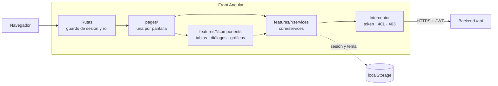
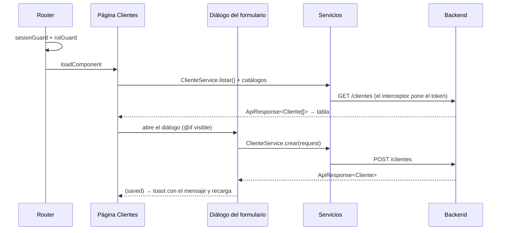

# Arquitectura

Este documento explica cómo está organizado el código del front, cómo fluye una pantalla desde la ruta hasta el backend y qué hay que tener en cuenta al agregar algo nuevo. Las reglas de negocio (cálculo, permisos, confidencialidad) están en la documentación del backend: aquí solo se cuenta cómo el front las respeta.

## Visión general

El front es una **aplicación Angular de una sola página** (SPA) que se publica como archivos estáticos. No tiene servidor propio: todo lo que muestra lo pide a la API del backend con un JWT, y lo único que guarda en el navegador es la sesión y el tema elegido.



El front **no decide permisos**: el backend responde 403 o 404 a lo que el usuario no puede ver. El menú por rol, los guards y los botones deshabilitados existen para que el usuario no llegue a pantallas que no le sirven, no como barrera de seguridad.

## Capas

```
src/app/
├── core/                        una sola instancia para toda la app
│   ├── guards/                  sesionGuard, sinSesionGuard, rolGuard
│   ├── interceptors/            authInterceptor: token, 401, 403, sin conexión
│   ├── models/                  ApiResponse/ApiError, sesión, enlace de contraseña
│   ├── services/                AuthService, CatalogoService (con caché), ThemeService
│   ├── theme/                   preset PsicoBatería de PrimeNG
│   └── utils/                   ResponseHandlerUtil, archivo.util, contrasena.util
├── shared/                      piezas sin estado que usan varios módulos
│   ├── components/error-campo/  mensaje de validación debajo de cada campo
│   ├── validators/              CustomValidators + mensajes en español
│   └── models/                  catálogos: Catalogo, Departamento, CiudadMunicipio…
├── features/{modulo}/           un módulo por área del negocio
│   ├── models/                  interfaces de lo que envía y recibe la API
│   ├── services/                un servicio por recurso de la API
│   └── components/              tablas, formularios, diálogos y gráficos del módulo
├── pages/{modulo}/{pantalla}/   una carpeta por ruta
└── layout/                      main-layout, sidebar, topbar y menu.ts
```

| Capa | Qué va ahí | Qué no va |
|---|---|---|
| `pages/` | La pantalla de una ruta: lee los parámetros de la URL, carga los datos, guarda el estado de la pantalla (filtros, fila elegida, diálogos abiertos) y arma la vista con componentes de `features` | Llamadas HTTP directas; formularios largos (van en un componente de diálogo) |
| `features/*/components` | Piezas de un área que reciben datos con `@Input` y avisan con `@Output`: tablas, formularios dentro de diálogos, acciones por fila, gráficos | Navegación; conocer de qué pantalla vienen |
| `features/*/services` | Una clase por recurso de la API (`ClienteService` → `/clientes`): arma la URL, desenvuelve `ApiResponse` y documenta qué rol puede usar cada método | Estado de pantalla; mensajes al usuario |
| `core/` | Lo transversal, con una sola instancia: sesión, interceptor, guards, caché de catálogos, tema | Cosas de un solo módulo |
| `shared/` | Lo reutilizable sin estado: validadores, error de campo, modelos de catálogos | Servicios con HTTP |

Los módulos de `features` son: `clientes` (empresas, personas, informes, estadísticas y sus gráficos), `aplicaciones`, `evaluados` (persona y relación con la empresa), `evaluadores`, `usuarios`, `cuestionarios` y `cuenta` (cambiar la propia contraseña). Un componente que nace en un módulo y luego sirve en otro se queda donde nació mientras no estorbe: por ejemplo, `app-barras-por-grupo` vive en `clientes` porque solo lo usan las estadísticas de la empresa.

## Flujo de una pantalla

Ejemplo: el administrador abre **Clientes** y crea uno.



Lo que muestra el ejemplo (página `ClienteListComponent`, diálogo `ClienteFormDialogComponent`):

1. **La ruta** decide si se entra (`sesionGuard`, `rolGuard` con `data.roles`) y carga la página bajo demanda.
2. **La página** pide en paralelo lo que necesita (`forkJoin`) y une los datos en el front, por ejemplo el nombre de la ciudad a partir de su id, con los catálogos ya cargados.
3. **El diálogo** es un componente de `features` que recibe la fila con `@Input`, guarda con su servicio y avisa con `@Output`. La página solo lo abre, lo cierra y recarga.
4. **El servicio** devuelve `data` cuando solo importa el dato y la `ApiResponse` completa cuando la pantalla muestra el `message` del backend (crear, actualizar, vincular).
5. **Los errores** los muestra cada pantalla con `ResponseHandlerUtil.handleError`. El 401, el 403 y la falta de conexión los resuelve el interceptor.

## Respuestas y errores

El backend responde siempre con el mismo formato:

| | Forma | En el front |
|---|---|---|
| Éxito | `ApiResponse<T>`: `{ success, message, data, timestamp }` | El servicio hace `map(r => r.data)`; si la pantalla muestra el mensaje, `ResponseHandlerUtil.handleResponse` lo pone en un toast "Listo" |
| Error | `ApiError`: `{ success: false, message, errorCode, details, timestamp }` | `ResponseHandlerUtil.handleError` arma el título según el código HTTP y usa el `message` del backend tal cual, más los `details` de validación |

| Código | Título del aviso | Tipo |
|---|---|---|
| 0 | Sin conexión | error |
| 400 | Datos inválidos | advertencia |
| 401 | — (no se avisa: el interceptor cierra la sesión o reingresa en desarrollo) | — |
| 403 | Sin permiso | error |
| 404 | No encontrado | error |
| 409 | No se puede completar | advertencia |
| 429 | Demasiados intentos | error |
| 500 y otros | Error | error |

Los mensajes del backend ya vienen en español y pensados para el usuario, así que el front no los traduce ni los reescribe. Cuando el error se muestra dentro de la pantalla o del diálogo en vez de un toast (login, contraseña actual incorrecta, enlace vencido, año sin informe, errores de la carga por archivo), se usa `ResponseHandlerUtil.describir` para obtener el texto.

Las **descargas** (Word, PDF, plantilla Excel) piden el archivo como `Blob`. Si el backend responde con error, ese `ApiError` también llega como `Blob`: `core/utils/archivo.util.ts` (`comoArchivo`) lo convierte de vuelta a JSON para mostrar el mensaje, y toma el nombre del archivo de `Content-Disposition`.

## Estado y sesión

No hay una librería de estado (ni NgRx ni similares). El estado vive en tres lugares:

| Dónde | Qué | Por qué basta |
|---|---|---|
| `AuthService.usuario` (`signal`) | El usuario de la sesión: nombre, correo, rol, cliente o evaluador vinculado | Lo leen el menú, la barra superior y las páginas con `computed` o `effect`; al cambiar de usuario de prueba, las páginas que lo escuchan recargan solas |
| `localStorage` | `token`, `token-expira`, `usuario` (sesión) y `app-theme` (claro u oscuro) | Sobrevive a recargar la página. La sesión se da por vencida un minuto antes de que expire el token (8 h) |
| Cada página | Listas, filtros, fila elegida, diálogos abiertos | Se pierde al salir de la pantalla, que es lo esperado: al volver se pide de nuevo al backend |

Algunos filtros van en la **URL** (`?anio=`, `?estado=`, `?idCliente=`) para poder enlazar una pantalla con otra en el mismo estado: el Inicio lleva a Aplicaciones ya filtrada, y el informe de empresa y las estadísticas comparten el año.

**Catálogos**: `CatalogoService` pide cada catálogo una sola vez por sesión del navegador y lo comparte (`shareReplay`); si la petición falla, se borra de la caché para que el siguiente intento vuelva a pedirlo. Se cargan completos (unas 1.100 ciudades) y las cascadas departamento → ciudad y sector → industria se filtran en el front, sin ir al servidor. Los de la ficha de datos generales (sexo, nivel académico, estrato…) se ordenan por id, que es el orden del cuestionario; los demás, alfabéticamente.

## Arranque de la aplicación

`app.config.ts` registra los proveedores: router, `HttpClient` con `authInterceptor`, PrimeNG con el preset PsicoBatería (modo oscuro con la clase `.dark`), animaciones, idioma `es-CO` (números con coma decimal, fechas en español) y el `MessageService` de los toasts.

Antes de mostrar nada, `provideAppInitializer` corre `inicializar`: aplica el tema guardado y, **solo en desarrollo**, entra con el primer usuario de `usuariosPrueba` (`AuthService.autoLogin`). En producción `usuariosPrueba` está vacío y el auto-login no hace nada.

## Rutas y carga perezosa

Todas las rutas están en `app.routes.ts`:

- **Públicas**, fuera del marco con menú: `/login` (con `sinSesionGuard`: con sesión vigente lleva al Inicio) y `/definir-contrasena` (sin guard: el enlace que llega por correo).
- **Privadas**, dentro de `MainLayoutComponent`: `sesionGuard` en `canActivate` y `canActivateChild`, y `rolGuard` en cada hija, que lee `data.roles`. Las listas de roles (`ADMIN`, `PSICOLOGO`, `PSICOLOGO_CLIENTE`, `ADMIN_PSICOLOGO`) copian la tabla de permisos del backend.
- Una ruta desconocida lleva a `/inicio`.

Cada página se carga con `loadComponent`, en su propio archivo JavaScript. Es necesario por el presupuesto de 1,5 MB del bundle inicial: PrimeNG y chart.js pesan, y sin carga perezosa todo entraría en el primer archivo. Solo `MainLayoutComponent` va importado directo, porque está en todas las pantallas privadas.

La digitación (`/aplicaciones/:id`) tiene además un `canDeactivate` que pregunta antes de salir si hay respuestas sin guardar.

El detalle de los guards, el interceptor y el menú está en [Seguridad](seguridad.md).

## Cómo agregar una pantalla

1. **Modelos** en `features/<modulo>/models/`: interfaces con los mismos nombres de campo que los DTO del backend (`ClienteRequest`, `Cliente`).
2. **Servicio** en `features/<modulo>/services/`: `@Injectable({ providedIn: 'root' })`, URL a partir de `environment.apiUrl`, `map(r => r.data)` donde solo importa el dato. En el comentario de la clase, qué roles pueden usarlo.
3. **Componentes** en `features/<modulo>/components/`: *standalone*, con su `.html` y `.scss`, inyección por constructor, datos por `@Input` y eventos por `@Output`. Un formulario va dentro de un `p-dialog` que la página envuelve en `@if (visible)`, para que se cree de nuevo en cada apertura.
4. **Página** en `pages/<modulo>/<pantalla>/` que arma la pantalla.
5. **Ruta** en `app.routes.ts` con `loadComponent` y `data: { roles: [...] }`, con los mismos roles que el backend permite para ese endpoint.
6. **Menú**: la opción en `layout/menu.ts`, solo para los roles que la pueden usar.
7. **Verificar** con `pnpm build` (que no pase el presupuesto) y en el navegador con un usuario de cada rol: el que debe entrar y el que no.
