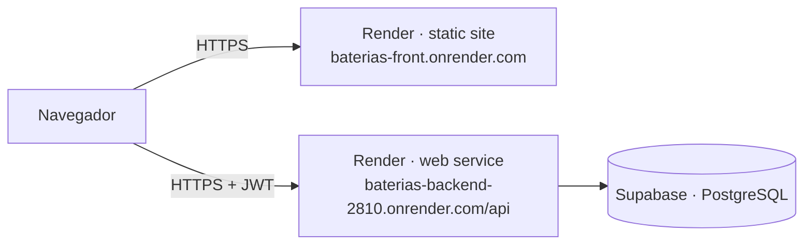

# Despliegue

Este documento explica cómo se publica el front en producción. El backend y la base de datos se despliegan aparte: ver `baterias_backend/docs/despliegue.md`.

## Dónde corre



| | Servicio | Plan |
|---|---|---|
| Front | Render, *static site* | Free |
| Backend | Render, *web service* con Docker | Free |

El front son solo archivos estáticos (HTML, JavaScript, CSS e íconos). El navegador los descarga del static site y luego habla **directo con el backend**; el static site no hace de intermediario.

## Configuración en Render

| Campo | Valor |
|---|---|
| Repositorio y rama | `baterias_front`, rama **`despliegue`** |
| Build command | `npx --yes pnpm@12.9.1 install --frozen-lockfile && npx --yes pnpm@12.9.1 run build` |
| Publish directory | `dist/baterias_front/browser` |
| Regla de reescritura | *Rewrite* de `/*` a `/index.html` |
| Versión de Node | La toma de `.node-version` (24) |

- **pnpm con `npx`**: Render trae pnpm en `/usr/bin`, que es de solo lectura, así que `corepack enable` falla con `EROFS`. `npx --yes pnpm@<versión>` descarga la versión exacta que fija `packageManager` en `package.json`. Si se actualiza pnpm, hay que cambiar la versión en los dos lugares.
- **`--frozen-lockfile`**: instala exactamente lo de `pnpm-lock.yaml` y falla si el lock no coincide con `package.json`. Si se agrega una dependencia, el `pnpm-lock.yaml` actualizado tiene que ir en el mismo commit.
- **Regla de reescritura**: Angular maneja las rutas en el navegador. Sin la regla, abrir directamente `https://baterias-front.onrender.com/definir-contrasena?codigo=…` (el enlace del correo) o recargar cualquier pantalla daría 404, porque no existe un archivo con esa ruta. La regla entrega `index.html` y Angular muestra la pantalla que corresponde.
- **No hay variables de entorno en Render**: la URL del backend está en `src/environments/environment.ts`, compilada dentro del JavaScript. No es un secreto: cualquiera la ve en el navegador.

## Relación con el backend

- `environment.ts` apunta a `https://baterias-backend-2810.onrender.com/api`. Si el backend cambia de URL, se cambia ahí y se vuelve a desplegar el front.
- El backend debe aceptar el origen del front en CORS: `APP_CORS_ORIGENES=https://baterias-front.onrender.com`, sin `/` al final.
- Los enlaces de los correos los arma el backend con `APP_FRONT_URL=https://baterias-front.onrender.com`. Esa variable va en el Secret File **del backend**, no en el static site.

## Cómo desplegar

Se trabaja en `main` y, cuando está listo, se mueve la rama `despliegue`:

```bash
pnpm build      # que compile y no pase el presupuesto
git push origin main
git branch -f despliegue main && git push origin despliegue
```

Render detecta el push y despliega solo; el build tarda unos minutos. Si el cambio también toca el backend, se despliega primero el backend (sobre todo si el front usa un endpoint nuevo) y luego el front.

Después de desplegar:

1. Abrir `https://baterias-front.onrender.com` y forzar la recarga (Cmd + Shift + R) para no ver la versión en caché.
2. Ingresar y probar lo que cambió.
3. Si es la primera petición en un rato, el backend puede estar dormido (ver abajo).

Un cambio solo de documentación (`docs/`, `README.md`) no necesita desplegarse.

## Problemas conocidos

| Síntoma | Causa | Qué hacer |
|---|---|---|
| "Sin conexión" el primer rato | El backend se duerme tras 15 minutos sin uso (plan Free) y tarda unos 2,5 minutos en arrancar | Esperar y volver a intentar. Se decidió dejarlo así (2026-11-24) |
| "Sin conexión" todo el tiempo, y en el log del backend `ENOTFOUND tenant/user … not found` | Supabase pausó el proyecto tras 7 días sin actividad (plan Free) | Restaurarlo en el panel de Supabase (*Restore project*) y redesplegar el backend |
| Error de CORS en la consola del navegador | La URL del front no está en `APP_CORS_ORIGENES` del backend | Agregarla en el Secret File del backend y redesplegar el backend |
| 404 al recargar una pantalla o al abrir el enlace de un correo | Falta la regla de reescritura | Agregar *Rewrite* `/*` → `/index.html` en Render |
| El build falla en `pnpm install` | `pnpm-lock.yaml` no coincide con `package.json` | Correr `pnpm install` en local y subir el lock |
| El build avisa que el bundle inicial pasa de 1,5 MB | Una página se importó directo en las rutas, o un import pesado entró en `core` o `layout` | Usar `loadComponent` en la ruta (ver [Arquitectura](arquitectura.md#rutas-y-carga-perezosa)) |
| Se ve el favicon viejo | Safari guarda los favicons por origen | Subir la versión `?v=` en `index.html` (ver [Gráficos y tema](graficos-y-tema.md#marca)) |
