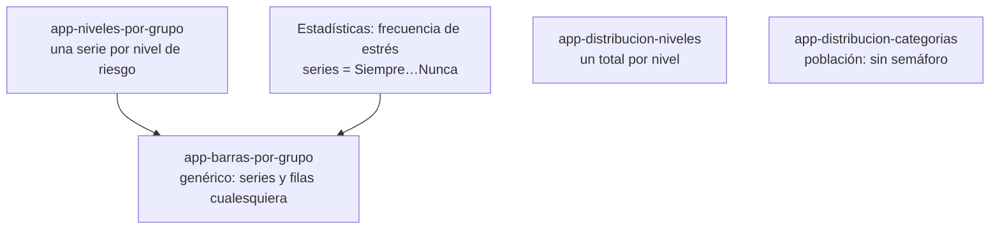

# Gráficos y tema

Este documento explica el aspecto visual de la aplicación: el tema de PrimeNG y el modo oscuro, los colores de los niveles de riesgo, los componentes de gráficos de las estadísticas y la marca PsicoBatería.

## Tema

- **PrimeNG 19 con el tema Aura** (`@primeuix/themes`). El preset propio `PsicoBateriaPreset` (`core/theme/psicobateria.preset.ts`) solo cambia el color primario: el **azul** del logo en lugar del esmeralda que trae Aura.
- **Modo oscuro** con la clase `.dark` en `<html>` (`darkModeSelector: '.dark'` en `app.config.ts`). `ThemeService` la pone o la quita, guarda la elección en `localStorage` (`app-theme`) y la expone como `signal` (`tema`). El botón está en la barra superior; por defecto se arranca en claro.
- **Colores en los estilos**: siempre las variables de PrimeNG (`var(--p-text-color)`, `var(--p-content-background)`, `var(--p-content-border-color)`, `var(--p-red-500)`…), nunca un color fijo, para que todo funcione en claro y en oscuro.
- **primeflex** para el diseño (`grid`, `col-12 md:col-6`, `flex`, márgenes) y **primeicons** para los íconos (`pi pi-...`).
- Fuente **Inter**, de Google Fonts, cargada en `styles.scss`; tamaño base de 14 px.

Los verdes que aparecen en la interfaz (éxito, "en orden", tarjeta de calculadas) son **semánticos**, no de la marca.

## Colores de los niveles

Los niveles de riesgo usan los mismos colores semáforo que el Word del informe de empresa (`DocxSoporte.COLOR_NIVEL` en el backend), para que la pantalla y el documento se lean igual:

| Nivel | Intralaboral, extralaboral y total | Estrés | Color |
|---|---|---|---|
| 1 | Sin riesgo o riesgo despreciable | Muy bajo | `#00B050` |
| 2 | Riesgo bajo | Bajo | `#92D050` |
| 3 | Riesgo medio | Medio | `#FFD700` |
| 4 | Riesgo alto | Alto | `#FF8C00` |
| 5 | Riesgo muy alto | Muy alto | `#E53935` |

- Están en `COLOR_NIVEL` (`features/clientes/models/informe-empresa.model.ts`), por `fkNivelRiesgo`. Los usan los resultados de una aplicación, el informe individual, el informe de empresa, las estadísticas y las tablas de baremos.
- Los **síntomas de estrés** usan el mismo número de nivel (1 a 5) con otras etiquetas: Muy bajo… Muy alto. Los componentes que los muestran tienen la entrada `[estres]`.
- Las **frecuencias** de respuesta de estrés (Siempre, Casi siempre, A veces, Casi nunca, Nunca) usan `colorFrecuencia`: Siempre en rojo y Nunca en verde, como en el Word.

**Contraste**: el amarillo y el verde claro tienen poco contraste sobre fondo blanco y no pasan como paleta categórica. Se mantienen por decisión del responsable, porque son los colores que el psicólogo y la empresa ya conocen. Para compensar, **siempre hay una tabla al lado del gráfico** (la lectura exacta), las barras tienen leyenda y llevan un borde tenue que las separa del fondo.

## Componentes de gráficos

Están en `features/clientes/components/`. Todos se usan en Estadísticas; `app-distribucion-niveles` también en el informe de empresa.

| Componente | Muestra | Ejemplo |
|---|---|---|
| `app-distribucion-niveles` | Cuántas personas hay en cada nivel, para un solo total | Nivel intralaboral de la empresa |
| `app-distribucion-categorias` | Tabla y barra de **un solo color** por categoría. No usa el semáforo, porque no son niveles de riesgo | Personas por sexo, edad, nivel académico |
| `app-barras-por-grupo` | Tabla con el % de cada serie (la cantidad en el tooltip) y **barras agrupadas**, una barra por serie y un grupo por fila | Frecuencia de los síntomas de estrés por dimensión |
| `app-niveles-por-grupo` | Envoltorio de `app-barras-por-grupo` con las 5 series de nivel en los colores semáforo | Ranking de dominios, niveles por ciudad o por área |

### Reglas de los gráficos

- **Tabla más barras agrupadas por nivel.** Ni barras 100 % apiladas ni mapas de calor: es preferencia del responsable y es igual que en el Word.
- Las filas van **en el orden en que llegan del backend**, que ya viene como ranking (primero la de mayor % en muy alto, después alto…). El front no reordena.
- Eje vertical de 0 a 100 %, de 25 en 25; los porcentajes con coma decimal y un decimal (`es-CO`).
- Los nombres largos del eje (síntomas, dimensiones) se parten en renglones de unos 18 caracteres, con un máximo de 4 y `…` al final. El nombre completo está en la tabla y en el tooltip.
- Con muchas filas, el gráfico se desplaza en horizontal. Con `[grafico]="false"` se muestra solo la tabla, por ejemplo en el ranking de dimensiones, que son demasiadas para un gráfico.
- La base de los porcentajes va en su columna. Cuando no son personas, se dice cómo se calcula: `1.256 (157 × 8)` = personas × ítems.

### Detalles de implementación

- chart.js 4.4.7 a través de `p-chart` (`primeng/chart`). Solo lo cargan las páginas que lo usan, gracias a `loadComponent`.
- **Los datos del gráfico se arman en `ngOnChanges`**, no en la plantilla. Si se crean en la plantilla, Angular ve un objeto nuevo en cada ciclo de detección de cambios y el gráfico se redibuja sin parar. Por lo mismo, las páginas arman sus filas una vez por vista.
- chart.js dibuja en un `<canvas>` y no lee las variables CSS. Por eso el color del texto y de la cuadrícula se toma de `getComputedStyle` (`--p-text-muted-color`, `--p-content-border-color`) y el gráfico se vuelve a armar cuando cambia `ThemeService.tema`.

## Marca

| Archivo | Uso |
|---|---|
| `public/logo.svg` | Logo: una cabeza con un medidor del nivel de riesgo, sobre fondo azul `#1e3a8a`. Va en el login, en el encabezado del menú lateral y como favicon en los navegadores que aceptan SVG |
| `public/favicon.ico` | Favicon de 16, 32 y 48 px, con las esquinas transparentes |
| `public/apple-touch-icon.png` | Ícono al guardar la página en la pantalla de inicio de iOS. Es cuadrado, porque iOS redondea las esquinas |

En `index.html`: título "PsicoBatería", descripción, `theme-color` `#1e3a8a` y los tres íconos con `?v=2`. **Si cambia el logo, hay que subir ese número**: Safari guarda los favicons por origen y no los vuelve a pedir aunque el archivo cambie.

El nombre se escribe "Psico" + "Batería", con "Batería" en azul, en el login y en el menú. Es el mismo azul (`#1e3a8a`) del encabezado de los correos y del manual técnico del backend.
