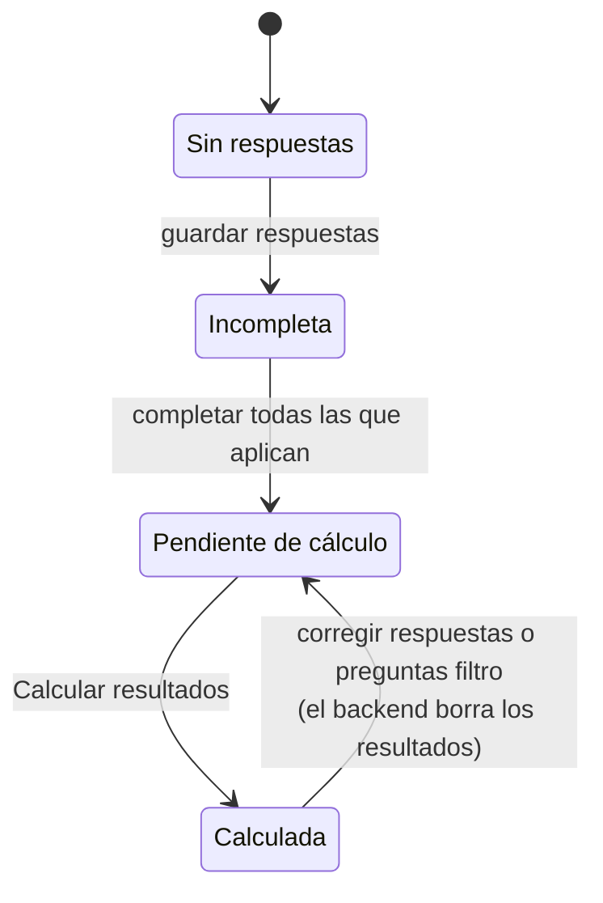

# Pantallas

Este documento es el mapa de la aplicación: qué pantallas hay, quién las ve, qué hace cada una y qué endpoints usa. Las reglas de negocio que hay detrás (cálculo, confidencialidad, participantes del año) están en la documentación del backend; aquí solo se cuenta lo que el usuario ve y hace.

## Mapa de rutas

| Ruta | Pantalla | Roles | Carpeta |
|---|---|---|---|
| `/login` | Ingreso | sin sesión | `pages/login` |
| `/definir-contrasena?codigo=` | Definir contraseña (enlace del correo) | pública | `pages/definir-contrasena` |
| `/inicio` | Inicio, distinto por rol | todos | `pages/inicio` |
| `/clientes` | Clientes | ADMIN, PSICOLOGO | `pages/clientes/cliente-list` |
| `/clientes/:id/personas` | Personas de la empresa | PSICOLOGO | `pages/clientes/cliente-personas` |
| `/clientes/:id/informe?anio=` | Informe de empresa | PSICOLOGO, CLIENTE | `pages/clientes/cliente-informe` |
| `/clientes/:id/estadisticas?anio=` | Estadísticas de la empresa | PSICOLOGO, CLIENTE | `pages/clientes/cliente-estadisticas` |
| `/aplicaciones?anio=&estado=&idCliente=` | Aplicaciones | PSICOLOGO | `pages/aplicaciones/aplicacion-list` |
| `/aplicaciones/:id` | Digitar una aplicación | PSICOLOGO | `pages/aplicaciones/aplicacion-digitar` |
| `/administracion/usuarios` | Usuarios | ADMIN | `pages/administracion/usuario-list` |
| `/administracion/evaluadores` | Evaluadores | ADMIN | `pages/administracion/evaluador-list` |
| `/configuracion/catalogos` | Catálogos | ADMIN, PSICOLOGO | `pages/configuracion/catalogo-list` |
| `/configuracion/cuestionarios` | Cuestionarios | ADMIN, PSICOLOGO | `pages/configuracion/cuestionario-estructura` |
| `/mi-firma` | Mi firma | PSICOLOGO | `pages/perfil/mi-firma` |

El CLIENTE, además, solo entra a las rutas `/clientes/:id/...` de **su** empresa. El EVALUADO solo ve el Inicio, con un aviso: el rol está previsto para que el trabajador responda en línea más adelante.

## Menú por rol

| Rol | Menú lateral |
|---|---|
| PSICOLOGO | Inicio · **Trabajo** (Clientes, Aplicaciones) · **Configuración** (Catálogos, Cuestionarios) |
| ADMIN | Inicio · Clientes · **Administración** (Usuarios, Evaluadores) · **Configuración** (Catálogos, Cuestionarios) |
| CLIENTE | Inicio · **Mi empresa** (Informe de empresa, Estadísticas) |
| EVALUADO | Inicio |

El menú de la barra superior (clic en el nombre) tiene **Mi firma** (solo el psicólogo), **Cambiar mi contraseña** y **Cerrar sesión**. La barra también trae el botón de tema claro u oscuro y, solo en desarrollo, el selector **Usuario de prueba**.

## Inicio

Cambia según el rol. Nunca muestra niveles de riesgo ni mezcla datos de varias empresas.

| Rol | Qué ve |
|---|---|
| PSICOLOGO | Saludo y año; aviso si su firma no está cargada; tarjetas con sus aplicaciones del año por estado (cada una lleva a Aplicaciones filtrada); **Para continuar** (las 8 aplicaciones sin terminar más recientes, con su avance); **Mis clientes** con lo calculado y lo pendiente del año y accesos a Personas, Informe y Estadísticas |
| ADMIN | Contadores (clientes, psicólogos activos, usuarios de clientes, evaluadores activos); **Configuración pendiente**: evaluadores activos sin firma o sin usuario, psicólogos sin clientes y clientes sin psicólogo; accesos directos |
| CLIENTE | Accesos a su informe y a sus estadísticas |

## Clientes y personas

### Clientes (`/clientes`)

Listado con buscador. El psicólogo ve solo sus clientes asignados. El ⚙️ de cada fila abre `app-cliente-acciones` con cuatro tarjetas: **Editar datos** (solo ADMIN), **Personas** (solo PSICOLOGO), **Informe de empresa** y **Estadísticas**. Cada tarjeta que el rol no puede usar queda deshabilitada y dice quién sí.

Crear y editar (`app-cliente-form-dialog`, solo ADMIN) tiene cascadas sector → industria y departamento → ciudad. **El NIT no se puede editar**: el campo queda bloqueado y el backend también lo rechaza.

### Personas (`/clientes/:id/personas`)

Los trabajadores de la empresa: una fila por relación persona–empresa, con su cargo, área, ciudad y la última aplicación. Arriba, tarjetas de resumen por situación que filtran la tabla; el listado arranca en **Activos** y la tarjeta **Inactivas** muestra los retirados.

| Acción | Componente | Qué hace |
|---|---|---|
| Vincular persona | `app-vincular-persona-dialog` | Formulario con secciones Persona, Datos personales y Datos laborales. **No busca ni prellena por documento**: el mensaje del backend dice si fue nueva, si se vinculó, si se actualizó o si cambió de empresa |
| Descargar plantilla | — | Excel **siempre vacío** (nunca trae las personas ya cargadas) |
| Cargar archivo | `app-carga-personas-dialog` | Valida el `.xlsx` al elegirlo, muestra el resumen por resultado y cada fila con sus errores. **Confirmar carga** solo se habilita sin errores, y guarda todas las filas o ninguna |
| ⚙️ → Editar | `app-vincular-persona-dialog` en modo edición | Documento bloqueado; guarda la relación y, si cambió, también la persona. Deshabilitado en relaciones inactivas: conservan la foto con que se evaluó |
| ⚙️ → Inactivar / Activar | `app-persona-estado-dialog` | Inactiva con fecha de retiro. Activar falla (409) si la persona está activa en otra empresa |
| ⚙️ → Aplicaciones | `app-persona-aplicaciones-dialog` | Las aplicaciones de la relación y **Nueva aplicación** (ver abajo) |
| ⚙️ → Informe individual | `app-informe-individual-dialog` | Ver abajo |

## Aplicaciones

### Crear una aplicación

Desde Personas, ⚙️ → Aplicaciones → **Nueva aplicación**:

- **Fecha** de aplicación, que no puede ser futura.
- **Forma A o B**, que elige el psicólogo: dos tarjetas con la descripción de los grupos ocupacionales del manual (A: jefes, profesionales y técnicos; B: auxiliares y operarios), sin ninguna marcada por defecto. Se muestra el tipo de cargo registrado y, si no coincide con la forma elegida, aparece un aviso que no bloquea.
- **¿Atiende clientes?**, obligatoria; **¿Es jefe?**, solo y obligatoria en la forma A.
- **Firmante**, opcional y solo el propio psicólogo.

Una relación inactiva no permite crear aplicaciones.

### Digitar (`/aplicaciones/:id`)

- Encabezado con la persona, la empresa, la fecha y el **estado**, que calcula el backend.
- Una **pestaña por cuestionario** (A o B, C, D) con su avance y una marca si tiene cambios sin guardar.
- Cada pregunta muestra un **ícono** de respondida o sin responder en lugar de su número.
- **Teclado**: del 1 al número de opciones responde y pasa a la siguiente; ↑, ↓ y Enter mueven; 0 o Supr borran la respuesta.
- Las **preguntas filtro** (atiende clientes, es jefe) aparecen antes del bloque al que afectan y solo se cambian sin cambios pendientes, porque recargan el formulario.
- **Guardar** reemplaza las respuestas de ese cuestionario. Si había resultados, el mensaje del backend avisa que se borraron.
- **Calcular resultados** solo se habilita en *Pendiente de cálculo* y sin cambios sin guardar. Una aplicación incompleta **nunca** se calcula: el botón dice qué preguntas faltan.
- Con resultados, `app-resultados-aplicacion` muestra el puntaje transformado y el nivel de cada cuestionario y del total general.
- Si hay cambios sin guardar, pide confirmación antes de salir: al navegar (`canDeactivate`) y al cerrar o recargar la pestaña (`beforeunload`).

### Listado (`/aplicaciones`)

Todas las aplicaciones de los clientes del psicólogo (`GET /aplicaciones/listado`): tarjetas por estado, filtros de empresa, año (arranca en el actual) y texto, y una tabla con el avance y el firmante; ✏️ abre la digitación. **Calcular pendientes (n)** calcula, una por una, las *Pendiente de cálculo* de la empresa y el año elegidos, con barra de progreso y la lista de las que fallaron. Las aplicaciones se crean desde Personas, no desde aquí.

## Informes

### Informe individual (diálogo desde Personas)

Lo ve cualquier psicólogo asignado a la empresa. Por año, una tarjeta por aplicación con:

- Los resultados de cada cuestionario y del total general. **Ver detalle** abre los dominios y las dimensiones; en estrés, los síntomas respondidos *Siempre* o *Casi siempre*, por grupo.
- **Firmante** (el propio o el que ya tenía; una vez puesto no se quita), **observaciones** y **recomendaciones**. Se guardan con GET + PUT de la aplicación, para no pisar el resto de sus datos.
- **Descargar PDF o Word**, deshabilitado mientras falten resultados o firmante, o haya cambios sin guardar; el botón dice qué falta. Si el firmante no tiene la firma cargada, solo aparece un aviso.

### Informe de empresa (`/clientes/:id/informe`)

- Selector de año (en la URL, compartido con Estadísticas).
- Resumen: cobertura (esperados, evaluados, pendientes), **nivel de riesgo de la empresa y periodicidad** de la próxima evaluación, y resultados globales (`app-distribucion-niveles`).
- **Conclusiones**, las tres acciones del plan (corto, mediano y largo plazo) y el firmante, en `app-informe-conclusiones`.
- **Descargar Word**, habilitado cuando `conclusiones.faltantes` viene vacío.
- El CLIENTE lo ve en solo lectura.

El detalle por forma, ciudad y área queda en el Word y en Estadísticas.

### Estadísticas (`/clientes/:id/estadisticas`)

Lo mismo que el Word, pero en pantalla. Cuatro pestañas:

| Pestaña | Contenido |
|---|---|
| Población | Esperadas, evaluadas y pendientes; cobertura por ciudad; distribución por forma, sexo, rango de edad, nivel académico, tipo de cargo y de contrato (`app-distribucion-categorias`) |
| Intralaboral | Selector Forma A / Forma B / A + B. En una forma: ranking de dominios, de dimensiones y una tarjeta por dominio. En A + B: dominios, por ciudad y por área |
| Extralaboral | Nivel total, ranking de dimensiones, por ciudad y por área |
| Estrés | Nivel total, frecuencia por dimensión (base personas × ítems), por ciudad, por área y por síntoma |

Los grupos con menos de 2 personas se juntan en "Otras ciudades/áreas" o se omiten con una nota: la regla de confidencialidad la aplica el backend. Los gráficos se explican en [Gráficos y tema](graficos-y-tema.md).

## Administración

### Usuarios (`/administracion/usuarios`)

Listado con rol, vínculo (evaluador o empresa), clientes asignados de cada psicólogo y **estado de la contraseña**, con buscador y filtros por rol y por contraseña.

La columna **Contraseña** responde "¿ya puede ingresar?":
- *Definida*, en gris: ya tiene contraseña.
- *Pendiente*, en amarillo, con la fecha en que vence su enlace: tiene uno sin usar. Si dice que no le llegó el correo, se le genera otro.
- *Sin enlace vigente*, en rojo: no tiene contraseña y su enlace venció o se anuló. Hay que generarle otro (si está inactivo, al activarlo).

Al generar un enlace, el listado se recarga y el usuario pasa a *Pendiente*.

| Acción | Componente | Qué hace |
|---|---|---|
| Nuevo usuario / ⚙️ → Editar datos | `app-usuario-form-dialog` | Correo, nombre, rol y vínculo según el rol (evaluador activo sin usuario, o empresa). **Sin contraseña**: al crear, avisa que la invitación llega por correo. El rol EVALUADO no se ofrece. Nadie se cambia su propio rol ni su estado |
| ⚙️ → Clientes asignados | `app-clientes-asignados-dialog` | Casillas con búsqueda y marcar todos o ninguno sobre lo visible; reemplaza la lista completa |
| ⚙️ → Enlace de contraseña | `app-usuario-enlace-dialog` | Confirma las consecuencias (la contraseña actual deja de servir, se cierran sus sesiones, se anulan los enlaces anteriores) y genera el enlace, que llega por correo. Deshabilitado en la fila propia y en usuarios inactivos |

### Evaluadores (`/administracion/evaluadores`)

Listado con estado y si tienen la firma cargada. ⚙️ → **Editar datos** (`app-evaluador-form-dialog`, con aviso al inactivar) y **Firma** (`app-evaluador-firma-dialog`: la actual y la nueva sobre fondo blanco; PNG o JPG de hasta 1 MB).

### Mi firma (`/mi-firma`)

El psicólogo ve sus datos de evaluador en lectura y carga su propia firma con el mismo diálogo. Se llega desde el menú de su nombre o desde el aviso del Inicio.

## Configuración (solo lectura)

Los datos maestros se cambian por migración en el backend, no desde aquí.

- **Catálogos**: lista agrupada (ficha de datos generales, ubicación, empresas, batería) y una tabla con buscador. Algunos catálogos tienen columnas propias: la forma del tipo de cargo, el departamento y el código DANE de las ciudades, el sector de las industrias.
- **Cuestionarios**: una pestaña por cuestionario (A, B, C, D) y una de Total general. Muestra el método de cálculo explicado, el factor, los baremos del total, las escalas con su puntaje, un buscador de preguntas y el árbol dominios → dimensiones (en C y D solo dimensiones) con condiciones, tolerancias, pesos y baremos (`app-tabla-baremos`).

## Cuenta

- **Definir contraseña** (`/definir-contrasena?codigo=`): pública, fuera del marco con menú. Si el enlace no está vigente, muestra solo el mensaje del backend, que remite al administrador por teléfono. Si está vigente, pide la contraseña dos veces; al guardar cierra la sesión que hubiera en el navegador y lleva al login con el correo ya escrito y el aviso "Contraseña definida".
- **Cambiar mi contraseña** (menú del nombre, todos los roles): actual, nueva y confirmación. Los errores (actual incorrecta, nueva igual, demasiados intentos) se muestran dentro del diálogo. El backend cierra las sesiones de otros equipos y devuelve un token nuevo, que reemplaza al actual.

El detalle del ingreso y las sesiones está en [Seguridad](seguridad.md).
