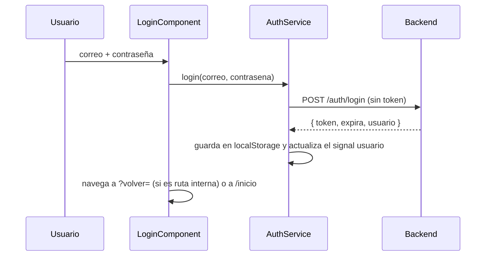
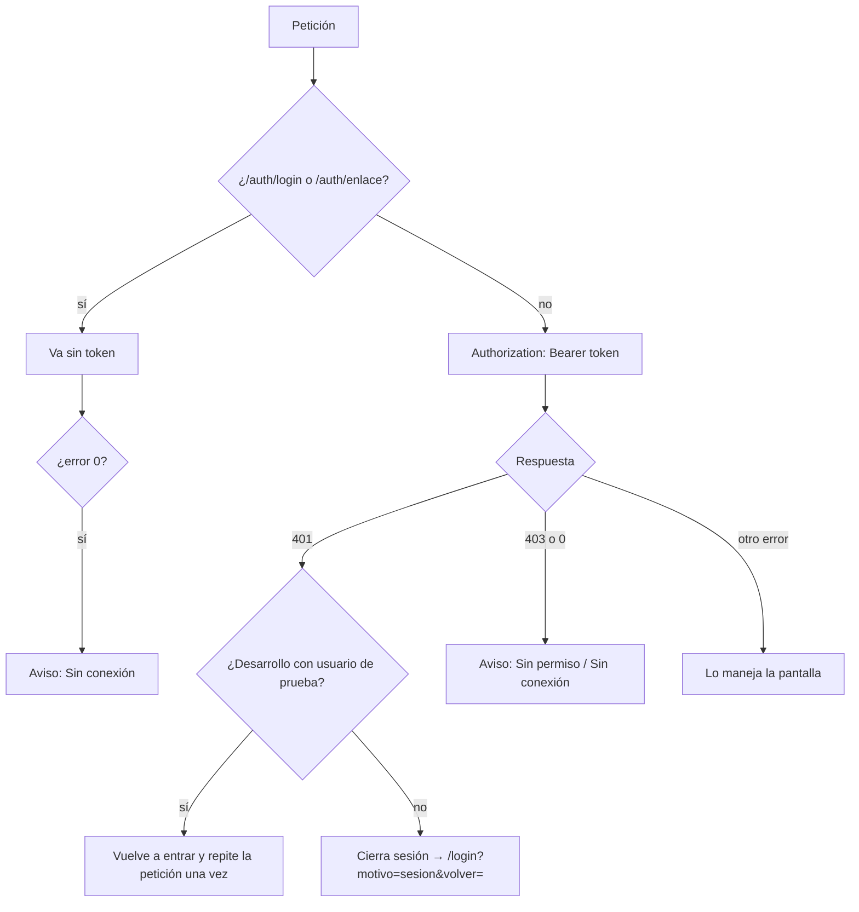
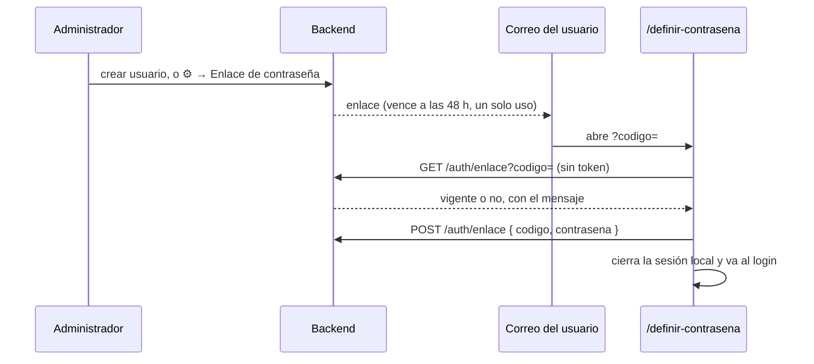

# Seguridad

Este documento explica cómo el front maneja el ingreso, la sesión, los permisos por rol y las contraseñas. El punto de partida es siempre el mismo: **la seguridad la aplica el backend**. Cada petición lleva el token y el backend decide si responde, con 401, 403 o 404 si no. Lo que hace el front (guards, menú por rol, botones deshabilitados) sirve para que el usuario no termine en pantallas a medias, pero nada de eso protege datos por sí solo.

El detalle del lado del servidor (JWT, permisos, alcance por cliente, freno a la fuerza bruta, enlaces de contraseña) está en `baterias_backend/docs/seguridad.md`.

## Ingreso y sesión

- El correo se envía en minúsculas. El error del backend se muestra tal cual en el formulario: 401 "Usuario o contraseña incorrectos" y 429, que ya trae los minutos de espera (el front no lee `Retry-After`, porque CORS no expone ese encabezado).
- `AuthService` guarda `token`, `token-expira` y `usuario` en `localStorage`. El usuario queda además en un `signal` que leen el menú, la barra y las páginas.
- La sesión se da por **vencida un minuto antes** de la hora de expiración del token (8 h), para no enviar peticiones con un token a punto de vencer.
- **Cerrar sesión** borra la sesión local y luego navega al login, en ese orden: con la sesión todavía vigente, el guard del login devolvería al Inicio. El JWT no se revoca en el servidor; vence solo.
- El rol que guarda el front es solo para mostrar. El backend lee el rol y el estado del usuario de la base en cada petición: si el administrador lo inactiva o le cambia el rol, la siguiente petición ya responde según eso.

## Guards

| Guard | Dónde | Qué hace |
|---|---|---|
| `sesionGuard` | `canActivate` y `canActivateChild` del marco con menú | Sin sesión vigente, borra lo que hubiera y lleva a `/login?volver=<ruta pedida>` |
| `sinSesionGuard` | `/login` | Con sesión vigente, lleva al Inicio |
| `rolGuard` | `canActivateChild` del marco | Compara el rol con `data.roles` de la ruta (sin `roles` = cualquiera con sesión). El CLIENTE además solo entra si el `:id` de la ruta es su empresa. Si no, avisa "Su usuario no tiene acceso a esa pantalla" y lleva al Inicio |

`rutaInterna` valida el parámetro `?volver=`: solo acepta rutas que empiezan por `/` y no por `//` (que sería otro sitio) ni por `/login`. Así un enlace preparado no puede usar el login para mandar al usuario fuera de la aplicación.

Los roles de cada ruta (`ADMIN`, `PSICOLOGO`, `PSICOLOGO_CLIENTE`, `ADMIN_PSICOLOGO` en `app.routes.ts`) copian la tabla de permisos del backend (`SecurityConfig`). **Si cambia un permiso en el backend, hay que cambiar también la ruta y el menú.**

## Interceptor

`authInterceptor` envuelve todas las peticiones HTTP.

- **Rutas públicas sin token**: `/auth/login` y `/auth/enlace`. Si el navegador tiene guardada una sesión vencida y la petición la llevara, el backend respondería 401 aunque la ruta sea abierta. Pasa con el enlace de contraseña, que muchas veces se abre en un equipo donde alguien ingresó hace días.
- **401** (token vencido, usuario inactivado, contraseña cambiada desde otro equipo): en producción cierra la sesión y lleva al login con "Su sesión terminó" y la ruta donde estaba. En desarrollo vuelve a entrar con el usuario de prueba y repite la petición una sola vez. Las pantallas no avisan el 401: `ResponseHandlerUtil.handleError` lo ignora.
- **403** y **sin conexión** se avisan aquí, una vez para toda la app. El resto de los errores (400, 404, 409, 429, 500) los maneja cada pantalla, porque solo ella sabe qué hacer con ellos.

## Menú y botones por rol

`layout/menu.ts` (`menuPara(usuario)`) arma el menú lateral según el rol: ver [Pantallas](pantallas.md). Dentro de las pantallas, lo que el rol no puede usar se **deshabilita con el motivo** ("Solo el administrador", "Solo el psicólogo") en vez de ocultarse, para que se entienda por qué no está disponible.

El ADMIN no ve informes ni datos de trabajadores. Por eso, en Usuarios, un usuario EVALUADO aparece sin nombre.

## Contraseñas

El administrador **nunca ve ni escribe contraseñas**. Las contraseñas se definen con un enlace que llega por correo:

- `/definir-contrasena` es pública: está fuera del marco y sin guard. Si el enlace no está vigente (vencido, usado, anulado o inválido), solo muestra el mensaje del backend, que remite al administrador por teléfono. **No existe "¿Olvidó su contraseña?"**: quien la olvida llama al administrador.
- Al guardar, cierra la sesión que hubiera en ese navegador, porque podría ser de otra persona, y lleva al login con el correo ya escrito.
- Si el enlace vence o se usa mientras la página estaba abierta, el 409 reemplaza el formulario por el mensaje.
- **Cambiar mi contraseña** (`PUT /auth/contrasena`): el backend cierra todas las sesiones del usuario y devuelve un **token nuevo**, que `AuthService.cambiarContrasena` guarda para que la sesión actual siga. Los intentos fallidos cuentan para el mismo freno del login (429).
- Largo de la contraseña: de 8 a 72 caracteres (`CONTRASENA_MINIMO` y `CONTRASENA_MAXIMO` en `core/utils/contrasena.util.ts`, iguales a los del backend).

## Ayudas de desarrollo

Solo funcionan con `environment.production = false`, es decir, con `pnpm dev`:

| Ayuda | Dónde |
|---|---|
| Auto-login con el primer usuario de `usuariosPrueba` | `AuthService.autoLogin`, al arrancar |
| Selector **Usuario de prueba** | Barra superior. Si el rol cambia, lleva al Inicio, porque la pantalla actual puede no estar permitida para el nuevo rol |
| Botones **Entrar como** | Login |
| Reingreso automático ante un 401 | `authInterceptor` |
| Datos de sesión y prueba de conexión | Inicio |

`AuthService.usuariosPrueba()` devuelve una lista vacía en producción, y `environment.ts` tampoco trae usuarios, así que ninguna de estas ayudas aparece en el build de producción. Se dejan en el código a propósito (ver [Decisiones](decisiones.md)).

**Las contraseñas de los usuarios de prueba** están en `environment.development.ts`, que no va a git. Si cambia la contraseña de uno de esos usuarios, hay que actualizarla ahí; si no, falla el auto-login o el reingreso.
